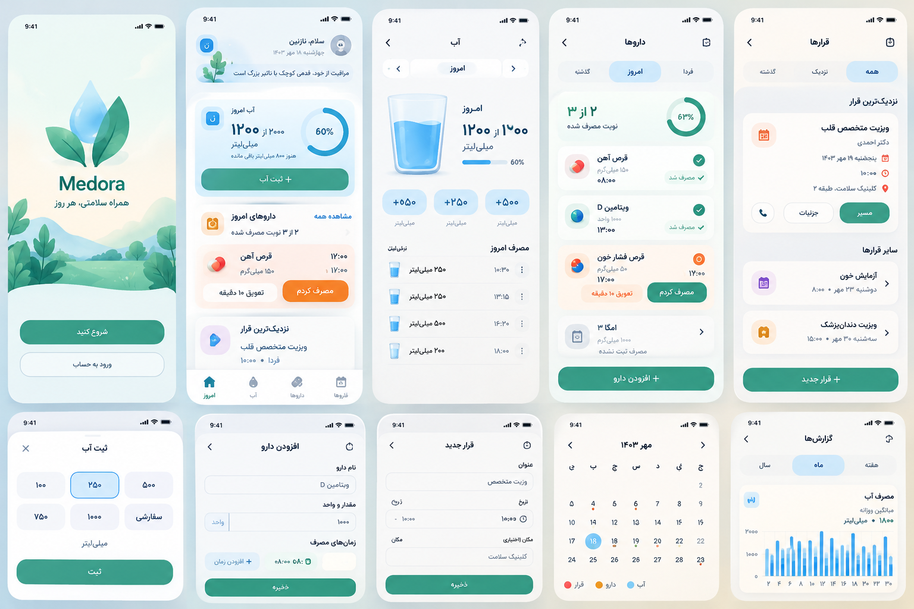

# Medora — approved Soft Wellness reference



The reference defines the light theme: teal actions, blue hydration visuals, warm medication cards, lavender appointment accents, rounded white surfaces, and Persian typography. Interface wording is corrected rather than copying generated image text. The app remains local and has no login or invented account flow.

## Implementation

- `DesignSystem.kt`: reference palette, bundled Vazirmatn typography, shapes, system dark theme.
- `WellnessComponents.kt`: shared actions, icons, circular water progress, a Canvas glass and capsule, and the welcome droplet/leaves. All artwork is offline.
- `MainActivity.kt`: greeting, Today summary and next actionable medication, hydration history, medication schedules, appointment filters, and navigation. Calendar and Reports are available in the top overflow menu. Settings remains available on every main screen.
- `Editors.kt`: scrollable bottom sheets, ready-made/custom water quantities, existing date/time controls, editable medication schedules, appointment forms, validation, and success feedback. Advanced fields are still available.
- `WellnessScreens.kt`: welcome, calendar activity markers and selected-day records, water trends, and medication status counts.
- `CareAnalytics.kt`: read-only future dose projection and historical reporting. Pending/snoozed doses are not counted as skipped. Future scheduled doses do not reduce historical adherence. Empty days are included in hydration averages. Annual charts group consecutive days into mean values to stay legible; the dotted line is the current daily target, not an invented historical target.

Existing encrypted storage, schema 5, application ID, notification actions and alarm planning are unchanged. The first-run welcome stores only its completion in separate UI preferences and is bypassed for existing health data/settings. No health records or future doses are written just by opening Reports or Calendar.

## Verification

```sh
./gradlew testDebugUnitTest assembleDebug assembleDebugAndroidTest lintDebug
./gradlew connectedDebugAndroidTest -Pandroid.testInstrumentationRunnerArguments.class=ir.medora.health.WellnessUiTest
```

`WellnessUiTest` renders production Compose screens, checks that water saved from the sheet updates real persisted storage, and captures screenshots for light Persian and dark English layouts. Fixture data appears only in tests.

The `Wellness UI screenshots` workflow runs on an Android emulator and uploads `medora-ui-screenshots`. Download those screenshots and compare the card proportions, text wrapping, progress artwork, forms and navigation with the reference. This is a device-level review, not a claim of pixel accuracy based on compilation alone.

Also review a narrow device, 200% text scale, TalkBack, dark Persian, English LTR, long medication names, custom quantities, date/time changes, cancelled appointments, and empty states. Primary action targets are at least 48dp and long forms scroll with the keyboard.

## Environment limitation

The editing environment has no Android SDK/emulator and cannot download Gradle (`Network is unreachable`). Compilation, instrumentation and screenshot checks must run in GitHub Actions or Android Studio. Visual equivalence remains pending until actual device screenshots have been examined.
